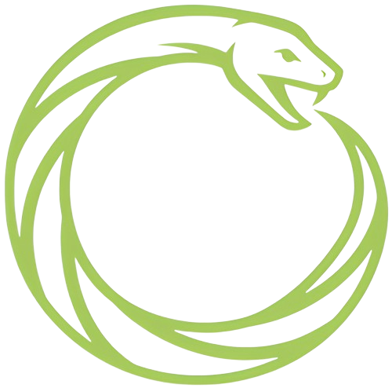
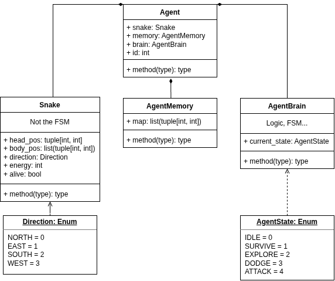

<div align="center">
  
  <h1>Ouroboros — Intelligent Snake</h1>
  <p><strong>An autonomous, competitive multi-agent AI simulation in Python &amp; Pygame.</strong></p>

  <p>
    
    
    
    
  </p>
</div>

---

## Overview

**Ouroboros** reimagines the classic Snake game as a real-time **Battle Royale simulation** where **2 to 4 autonomous AI snakes** compete for survival and limited resources on a **partially observable, toroidal (wrap-around) grid**.

Each snake perceives the world through a restricted forward-facing **vision cone**, remembers previously spotted food in **local memory**, and makes tactical decisions every tick via a **Finite State Machine (FSM)**.

---

## Agent Architecture

<div align="center">
  
</div>

### Finite State Machine (Priority Order)

| Priority | State | Trigger | Behavior |
| :---: | :--- | :--- | :--- |
| **1** | `HUNTING` | Another alive snake enters the vision cone (or lock-on active) | Pursues with lookahead, flanks around the toroidal map on stalled chases, or orbits to cut off the opponent |
| **2** | `TARGET` | Known food exists in local memory | Computes shortest toroidal path toward the nearest remembered apple |
| **3** | `DODGE` | Immediate cell ahead is blocked by another snake | Performs an evasive turn toward an open direction |
| **4** | `EXPLORATION` | Fallback state (path clear, no targets) | Patrols the grid to discover new food or opponents |

### Key Technical Highlights
- **Partially Observable World (`WorldView`)**: Each agent only sees cells inside a triangular forward-facing vision cone (rendered as a translucent colored overlay), forcing exploration and memory-driven decisions.
- **Toroidal Geometry**: Movement, vision, shortest-path calculations, and flanking all wrap seamlessly across map boundaries.
- **Emergent Multi-Agent Edge Cases Solved**:
  - *Stalled equal-speed pursuit* → solved with toroidal reverse-flanking (`_start_flank` / `_continue_flank`).
  - *Symmetric flank deadlocks* between identical agents → broken via randomized turn priority and hunt cooldowns.
  - *Frozen parallel orbits* → solved using fixed-step angular progression (`ENCIRCLE_ANGULAR_STEP`).
- **Clean Pygame Encapsulation**: Rendering, windowing, and events are isolated under `game/encapsulation/` for maintainability and testability.

---

## Quick Start

### Prerequisites
- Python **3.10+**
- GNU `make`

### 1. Setup Environment
```bash
python3 -m venv .venv
source .venv/bin/activate
pip install -r requirement.txt
```

### 2. Build & Launch (Settings Menu)
```bash
make re
./ouroboros
```
From the interactive menu, configure the **number of AIs (2–4)**, **grid size** (*Small / Medium / Big*), **food density**, and **fullscreen** mode.

### 3. Direct CLI Launch (Skip Menu)
```bash
./ouroboros --agent 3 --food 0.08 --grid 35 25 --tick 15 --fullscreen
```

| Flag | Description | Range | Default |
| :--- | :--- | :--- | :--- |
| `--agent N` | Number of competing AI snakes | `2` – `4` | `2` |
| `--food D` | Food spawn density | `0.01` – `2.00` | `0.05` |
| `--tick R` | Simulation speed (ticks/sec) | `1` – `60` | `10` |
| `--grid W H` | Custom grid dimensions (cells) | `4` – `200` | `32 24` |
| `--fullscreen` | Launch directly in fullscreen | flag | `False` |

---

## Running Tests

```bash
make test
```
Runs the `pytest` suite covering CLI argument parsing (`tests/parser/`) and toroidal grid mechanics (`tests/grid/`).

---

## Project Structure

```text
.
├── game/
│   ├── main.py             # Application entrypoint
│   ├── snake/              # FSM brain, vision (world_view), local memory, snake model
│   ├── grid/               # Toroidal grid logic
│   ├── entity/             # Food spawning & lifespan management
│   ├── render/             # Menu, HUD, sprites & Pygame game loop
│   ├── encapsulation/      # Pygame wrapper layer (window, render, rect, event)
│   └── parser/             # CLI argument validation
├── assets/                 # Custom Ouroboros logo, snake & apple sprites
├── doc/                    # Detailed architecture, FSM design journey & launch docs
├── tests/                  # Pytest unit tests
├── Makefile                # PyInstaller standalone build & test targets
└── requirement.txt
```

---

## Documentation

- [Introduction & Game Rules](doc/introduction.md)
- [FSM, Vision Cone, Memory & Design Journey](doc/states.md)
- [Pygame Encapsulation Layer](doc/encapsulation.md)
- [Full Launch & CLI Guide](doc/how_to_launch.md)

---

## Credits

Built by **Maëva Arroniz** ([@Maeva2630](https://github.com/Maeva2630)) and **Julie Vincent**.
